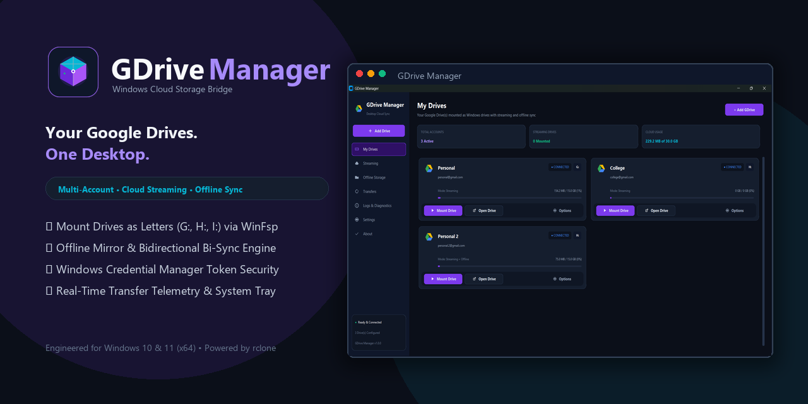
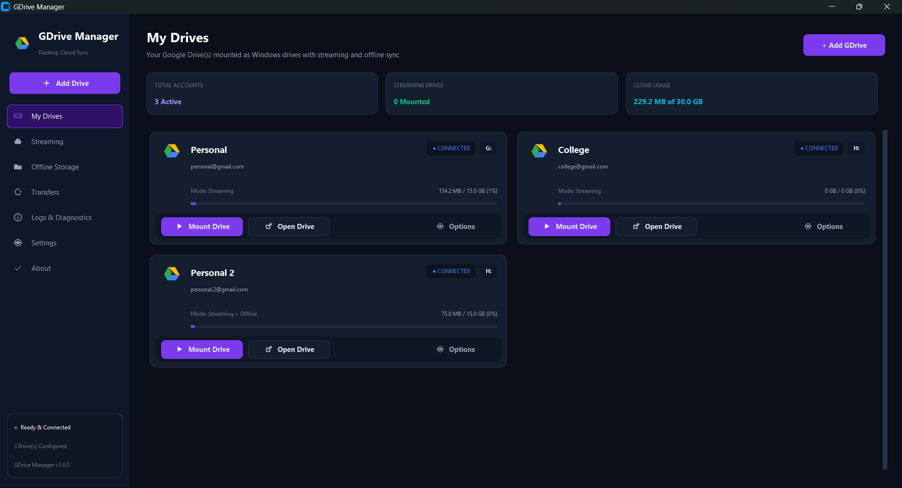
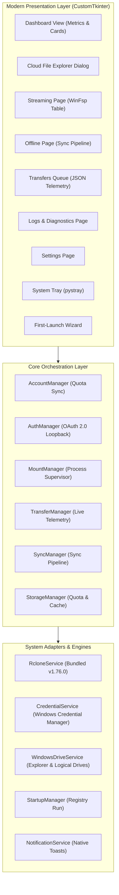

<div align="center">



# GDrive Manager

**Your Google Drives. One Desktop.**  
*Mount, stream, browse, and synchronize multiple Google Drive accounts seamlessly as native Windows drives.*

[](https://github.com/mohitbhatt-du/gdrive-manager/releases)
[](https://github.com/mohitbhatt-du/gdrive-manager/actions/workflows/ci.yml)
[](tests/)
[](https://microsoft.com/windows)
[](https://python.org)
[](https://github.com/astral-sh/ruff)
[](LICENSE)

<br/>

[Key Features](#-key-features) • [Why GDrive Manager?](#-why-gdrive-manager-comparison) • [Installation](#-installation) • [Usage Guide](#-usage-guide) • [Architecture](#-architecture) • [FAQ](#-frequently-asked-questions-faq) • [Documentation](#-documentation)

</div>

---

## 📸 Application Preview

<div align="center">


*Live GDrive Manager Dashboard showcasing multi-account streaming drives, real-time cloud quota telemetry, and one-click in-app browsing.*

</div>

---

## 🌟 Introduction

**GDrive Manager** is a modern, high-performance Windows desktop application designed for power users, developers, students, and enterprises managing multiple Google Drive accounts (Personal, Work, University, and Archives).

Instead of opening dozens of browser tabs or running heavy, conflicting background clients, GDrive Manager bridges Google Drive directly into **Windows File Explorer** and provides an integrated **In-App Cloud Browser**:

1. **Virtual Drive Streaming**: Mounts cloud drives as native Windows drive letters (`G:`, `H:`, `I:`, etc.) via [WinFsp](https://winfsp.dev/) and bundled [rclone](https://rclone.org/), accessing terabytes on-demand without filling your local SSD.
2. **In-App Cloud Browser**: Explore remote folders and access **"Shared with me"** files directly inside the application with zero drive mounting or WinFsp installation required.
3. **Selective Offline Sync Engine**: High-speed offline sync featuring Safe Copy, Cloud Mirror with dry-run protection, and Two-Way Bi-Sync with automated conflict resolution.
4. **Hybrid Storage Mode**: Operate simultaneous virtual streaming drive letters and dedicated local offline backup directories for the same account without conflict.
5. **Hardware-Encrypted Security**: OAuth 2.0 refresh credentials and user tokens are safeguarded directly inside **Windows Credential Manager** with zero plaintext keys on disk.

---

## ⚡ Key Features

- **Multi-Account Isolation**: Connect and manage unlimited Google Drive accounts simultaneously with independent settings, quota tracking, and drive letter mapping.
- **On-Demand Cloud Streaming**: Access all cloud files directly in Windows Explorer (`explorer.exe`) with intelligent chunk caching (`--vfs-cache-mode full`). Only requested byte ranges are downloaded.
- **Direct In-App Cloud Explorer**:
  - Visit and navigate remote Google Drive folders directly inside the app without needing WinFsp or Windows virtual drives.
  - Dedicated toggle for **"Shared with me"** files (`--drive-shared-with-me`).
  - Search filter, breadcrumb traversal, and one-click file downloading with native Windows Save As dialog.
  - Quick deep-linking to the Google Drive web client.
- **Dynamic Real-Time Dashboard**: Key metric pills (*Total Accounts*, *Streaming Drives*, *Cloud Storage Usage*) automatically update dynamically upon connecting drives, mounting, or unmounting.
- **Granular Offline Synchronization**:
  - **Safe Copy**: One-way file transfer preserving destination files.
  - **Mirror Sync**: Source replica synchronization with safety dry-run previews and destructive deletion warnings.
  - **Two-Way Bi-Sync**: Bidirectional synchronization with baseline reconciliation.
- **Real-Time Transfer Queue**: Live speed telemetry, byte progress, and ETA countdowns parsed from rclone's JSON telemetry stream with pause, resume, cancel, and retry controls.
- **Three-Tier Storage Breakdown**: Clear visual breakdown distinguishing Cloud Quota, Local Offline Storage, and Temporary VFS Streaming Chunks. One-click cache purging safely recovers SSD space.
- **Windows System Integration**:
  - System Tray minimization (`pystray`) with quick mount/unmount context menus.
  - Native Windows balloon notifications on transfer completions and mount events.
  - Windows autorun on startup option (`HKCU\Software\Microsoft\Windows\CurrentVersion\Run`).
  - Automatic drive letter collision detection and resolution.
- **Zero Plaintext Secrets**: Enterprise-grade credential encryption via Windows Credential Manager (`keyring` / Windows DPAPI).

---

## ⚖️ Why GDrive Manager? (Comparison)

| Feature | GDrive Manager | Google Drive for Desktop | RaiDrive (Free) | Air Live Drive |
|---|:---:|:---:|:---:|:---:|
| **Simultaneous Multi-Account** | ✅ Unlimited | ⚠️ Limited (up to 4) | ⚠️ Limited | ⚠️ Limited |
| **Native Windows Drive Letters** | ✅ Yes (`G:`, `H:`, `I:`) | ✅ Yes | ✅ Yes | ✅ Yes |
| **In-App Cloud Browser (No Mount)**| ✅ Yes (Built-in) | ❌ No | ❌ No | ❌ No |
| **"Shared with Me" Exploration** | ✅ Yes (Instant Toggle) | ⚠️ Requires Shortcut | ⚠️ Paid Only | ⚠️ Paid Only |
| **Two-Way Offline Bi-Sync** | ✅ Yes (Built-in) | ⚠️ Basic mirror only | ❌ Streaming only | ❌ Streaming only |
| **Dry-Run Transfer Preview** | ✅ Yes | ❌ No | ❌ No | ❌ No |
| **Credential Encryption** | ✅ Windows Credential Vault | ⚠️ Proprietary Cache | ⚠️ Proprietary | ⚠️ Proprietary |
| **Open Source & Free Forever** | ✅ Yes (MIT) | ❌ Proprietary | ❌ Proprietary / Ads | ❌ Commercial |
| **No Background Telemetry/Ads** | ✅ 100% Clean | ❌ Telemetry | ❌ Ads in Free Tier | ❌ Commercial |

---

## 🖥️ System Requirements

| Requirement | Specification |
|---|---|
| **Supported OS** | Windows 11 (64-bit), Windows 10 (Build 1809+, 64-bit) |
| **Architecture** | x86_64 (64-bit) |
| **Memory** | Minimum 512 MB RAM (2 GB recommended) |
| **Local Disk Space** | ~150 MB application files + configurable VFS chunk cache (default 10 GB) |
| **Filesystem Driver** | [WinFsp 2.0+](https://winfsp.dev/rel/) *(Required for virtual drive streaming; optional for in-app browser)* |
| **Cloud Engine** | Bundled `rclone v1.76.0` *(Included automatically in all release packages)* |

---

## 📦 Installation

### Option 1: Windows Setup Installer (`GDriveManager-Setup-x64.exe`) — Recommended
1. Download **`GDriveManager-Setup-x64.exe`** from [GitHub Releases](https://github.com/mohitbhatt-du/gdrive-manager/releases).
2. Double-click the installer and follow the setup wizard.
3. Choose your desired destination folder (default: `C:\Program Files\GDrive Manager`).
4. Select optional shortcuts (Desktop, Start Menu, or Startup launch).

### Option 2: Portable ZIP Archive (`GDriveManager-Windows-x64.zip`)
1. Download **`GDriveManager-Windows-x64.zip`** from [GitHub Releases](https://github.com/mohitbhatt-du/gdrive-manager/releases).
2. Extract the archive to any folder (e.g. `C:\Tools\GDriveManager`).
3. Double-click `GDriveManager.exe` to run immediately with zero installation.
4. All settings, logs, and token vaults are kept cleanly in `%LOCALAPPDATA%\GDriveManager`.

### Option 3: WinFsp Driver Setup (For Streaming Mode)
To stream cloud folders as Windows drive letters (`G:`, `H:`, etc.), install the free open-source WinFsp filesystem driver:
```powershell
winget install WinFsp.WinFsp
```
*(Alternatively, download the `.msi` directly from the [official WinFsp release page](https://winfsp.dev/rel/).)*

> [!NOTE]  
> If you do not install WinFsp, you can still use the **In-App Cloud Browser** to view, search, and download your files and "Shared with me" folders at any time!

---

## 🔑 Google OAuth 2.0 Setup

GDrive Manager connects directly to Google Drive via official OAuth 2.0 authorization:

1. Launch GDrive Manager and click **+ Add GDrive**.
2. Enter your account display name (e.g., `Personal`, `Work`, `Research`) and pick an available Windows drive letter (e.g. `G:`).
3. Select your operating mode (*Streaming Only*, *Offline Only*, or *Hybrid Mode*).
4. Click **Connect Google Drive**.
5. GDrive Manager launches your default web browser to Google's official sign-in page.
6. Grant Drive access permissions; once authorized, Google securely redirects to the local loopback listener.
7. Tokens are encrypted into **Windows Credential Manager**, and your drive is ready!

---

## 🚀 Usage Guide

### 1. In-App Cloud File Browser (No Mount Required)
- Click the **Browse** button on any Drive card in the Dashboard or Streaming table.
- Instantly browse cloud folders and subdirectories without mounting a drive letter.
- Toggle **Shared with Me** to explore files and team folders shared with your account.
- Use the search bar to filter files in real time.
- Click **Download File** to save files directly to your local computer.

### 2. Virtual Drive Streaming Mode
- Click **Mount Drive** on any connected drive card.
- Your Google Drive appears as a native Windows drive letter (e.g., `G:\`) in **This PC** and File Explorer.
- Click **Open Drive** to launch `explorer.exe` directly into the cloud volume.
- Open, edit, and stream videos or documents on demand. Files are cached locally and changes sync back seamlessly.

### 3. Selective Offline Storage Mode
- Navigate to **Offline Storage** in the sidebar.
- Select your Google Drive account and choose a local directory on your PC.
- Choose your sync operation:
  - `Safe Copy`: Uploads or downloads files without deleting destination data.
  - `Mirror / Sync`: Source replica synchronization with safety dry-run previews and destructive deletion warnings.
  - `Two-Way Bi-Sync`: Keeps local and cloud folders in sync with conflict detection.
- Check **Dry-Run Preview** to simulate transfers before moving real files.
- Track real-time progress, bandwidth speed, and ETAs in the **Transfers** queue.

### 4. Hybrid Storage Mode
- Combine both modes: Stream your entire 2 TB cloud drive as virtual drive `G:\` while keeping a specific critical project folder (e.g. `D:\WorkBackup`) synced offline for zero-latency offline access.
- Built-in conflict prevention prevents setting offline sync paths inside the virtual drive letter itself.

---

## ❓ Frequently Asked Questions (FAQ)

### Can I use GDrive Manager without installing WinFsp?
**Yes!** If you don't have WinFsp installed or don't want to mount Windows virtual drive letters, simply click **Browse** on any drive card to launch the built-in **Cloud File Browser**. You can navigate folders, search items, download files, and access "Shared with me" folders directly inside the app.

### Does GDrive Manager support multiple Google accounts at once?
**Yes.** You can add unlimited Google Drive accounts (Personal `@gmail.com`, Google Workspace, and University `@edu`). Each account receives its own isolated remote configuration, distinct Windows drive letter (`G:`, `H:`, `I:`, etc.), and dedicated VFS cache.

### Will streaming files consume my local hard drive storage?
**No.** In Streaming Mode, GDrive Manager uses on-demand chunk streaming (`--vfs-cache-mode full`). It only caches the specific portions of files you open, and cleans them up according to your configured cache size and TTL. You can purge the VFS streaming cache at any time from the Drive Settings dialog.

### Can I access Google Drive "Shared with me" files?
**Yes.** Open the In-App Cloud Browser and turn on the **Shared with Me** toggle switch. It immediately queries and displays all files and team folders shared with your Google account.

### How are my credentials and tokens secured?
All OAuth 2.0 refresh tokens are securely stored in the **Windows Credential Manager** (`keyring` backend) using Windows DPAPI with AES hardware-backed encryption. Plaintext secrets or passwords are never written to disk or transmitted to third-party servers.

### Is GDrive Manager completely free and open source?
**Yes.** GDrive Manager is 100% free, open source under the permissive MIT license, contains zero ads, and has zero telemetry or tracking.

---

## 🏛️ Architecture

GDrive Manager follows a clean, layered architecture separating CustomTkinter presentation, orchestration logic, and Windows system services:



---

## 🛠️ Development & Building from Source

### Setup Development Environment
```powershell
# 1. Clone repository
git clone https://github.com/mohitbhatt-du/gdrive-manager.git
cd gdrive-manager

# 2. Create virtual environment
python -m venv .venv
.\.venv\Scripts\Activate.ps1

# 3. Install development requirements
pip install -r requirements-dev.txt

# 4. Verify environment
python scripts/check_environment.py
```

### Running Tests
```powershell
# Run full test suite (60 tests)
pytest -v tests/

# Run with test coverage report
pytest -v --cov=app --cov-report=term-missing tests/
```

### Code Formatting & Linting
```powershell
# Check code style with Ruff
ruff check .

# Check formatting
ruff format --check .

# Type checking with Mypy
mypy app/
```

### Build Standalone Executable & Portable Archive
```powershell
python scripts/build.py
```
Compiled outputs:
- `dist/GDriveManager/GDriveManager.exe` (Standalone application)
- `dist/GDriveManager-Windows-x64.zip` (Portable ZIP archive)
- `dist/GDriveManager-Setup-x64.exe` (Inno Setup Windows installer)

---

## 📚 Documentation

Comprehensive technical documentation is available in the [`docs/`](docs/) directory:

- 📖 [Installation Guide](docs/installation.md): Step-by-step setup, winget instructions, and WinFsp installation.
- 🏛️ [System Architecture](docs/architecture.md): Deep-dive into process lifecycles, threading model, and telemetry parsing.
- ⚙️ [Configuration Guide](docs/configuration.md): VFS cache tuning, `accounts.json` schema, and drive letter rules.
- 🔧 [Troubleshooting Guide](docs/troubleshooting.md): Solutions for WinFsp errors, drive letter conflicts, and OAuth timeouts.
- 💻 [Developer Guide](docs/development.md): Environment setup, Pytest conventions, and packaging pipelines.
- 🔒 [Security Policy](docs/security.md): Threat modeling, token vaulting, and responsible disclosure.

---

## 🤝 Contributing

Contributions are welcome! Please read [CONTRIBUTING.md](CONTRIBUTING.md) and our [Code of Conduct](CODE_OF_CONDUCT.md) before opening pull requests.

---

## 🔒 Security

For security vulnerability reporting and our threat model, please refer to [SECURITY.md](SECURITY.md) and [docs/security.md](docs/security.md).

---

## 📄 License

GDrive Manager is open-source software licensed under the [MIT License](LICENSE).  
Copyright © 2026 GDrive Manager Contributors.

---

## 🔗 Official References

- [Rclone Official Documentation](https://rclone.org/)
- [WinFsp Official Documentation](https://winfsp.dev/)
- [Google Drive API & OAuth 2.0](https://developers.google.com/drive/api/guides/about-sdk)
- [CustomTkinter Documentation](https://customtkinter.tomschimansky.com/)
