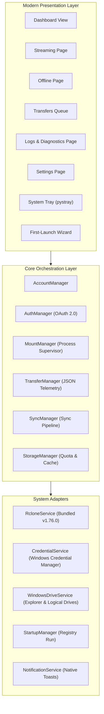

<div align="center">


# GDrive Manager

**Your Google Drives. One Desktop.**  
*Connect, stream, and synchronize multiple Google Drive accounts seamlessly as native Windows drives.*

[](.github/workflows/ci.yml)
[](https://microsoft.com/windows)
[](https://python.org)
[](LICENSE)
[](https://github.com/mohit/gdrive-manager/releases)

[Features](#-key-features) • [Installation](#-installation) • [Usage Guide](#-usage-guide) • [Architecture](#-architecture) • [Documentation](#-documentation)

</div>

---

## 📸 Application Preview

<div align="center">


*Live GDrive Manager Dashboard showing multi-account streaming drives, storage metrics, and quick actions.*

</div>

---

## 🌟 Introduction

**GDrive Manager** is a modern Windows desktop utility designed for power users, developers, and enterprises managing multiple Google Drive accounts (Personal, Work, University, and Archives). 

Instead of juggling browser tabs or running multiple conflicting sync clients, GDrive Manager bridges Google Drive directly into **Windows File Explorer** using:
1. **Streaming Mode**: Mounts cloud drives as native Windows drive letters (`G:`, `H:`, `I:`, etc.) via [WinFsp](https://winfsp.dev/) and [rclone](https://rclone.org/), accessing files on-demand without filling your local SSD.
2. **Offline Mode**: Granular selective sync (Safe Copy, Cloud Mirror with dry-run protection, and Two-Way Bi-Sync).
3. **Hybrid Mode**: Combines streaming and dedicated offline target directories for the same account without conflict.
4. **Enterprise Security**: Hardware-encrypted OAuth 2.0 credentials secured directly inside **Windows Credential Manager**.

---

## ⚡ Key Features

- **Multi-Account Isolation**: Connect unlimited personal, workplace, or institutional Google accounts simultaneously with separate drive letters.
- **On-Demand Cloud Streaming**: Direct access through Windows Explorer (`explorer.exe`) powered by `--vfs-cache-mode full` for fast file seeking, partial reads, and background uploads.
- **Selective Offline Synchronization**:
  - **Safe Copy**: One-way file transfer preserving existing destination files.
  - **Mirror Sync**: Source replica synchronization with safety dry-run previews and destructive deletion warnings.
  - **Two-Way Bi-Sync**: Bidirectional synchronization with baseline reconciliation.
- **Real-Time Transfer Queue**: Live speed telemetry, byte counters, and ETA countdowns parsed from rclone's JSON telemetry stream, with pause, resume, cancel, and retry controls.
- **Three-Tier Storage Breakdown**: Clear breakdown distinguishing Cloud Quota, Local Offline Storage, and Temporary VFS Streaming Chunks. One-click VFS cache purge safely frees local SSD space.
- **Windows Integration**:
  - System Tray minimization (`pystray`) with quick mount/unmount actions.
  - Native Windows balloon notifications on transfer completions and mount events.
  - Windows autorun on startup option (`HKCU\Software\Microsoft\Windows\CurrentVersion\Run`).
  - Automatic drive letter collision detection and resolution.
- **Hardware-Encrypted Security**: All OAuth tokens and refresh credentials are stored in Windows Credential Manager (`keyring`). No plaintext tokens on disk.

---

## 🖥️ System Requirements

| Requirement | Specification |
|---|---|
| **Supported OS** | Windows 11 (64-bit), Windows 10 (Build 1809+, 64-bit) |
| **Architecture** | x86_64 (64-bit) |
| **Memory** | Minimum 512 MB RAM (2 GB recommended) |
| **Local Disk Space** | ~150 MB application files + configurable VFS chunk cache (default 10 GB) |
| **Filesystem Driver** | [WinFsp 2.0+](https://winfsp.dev/rel/) (Required for virtual drive streaming) |
| **Cloud Engine** | Bundled `rclone v1.76.0` (included automatically in release packages) |

---

## 📦 Installation

### Option 1: Windows Setup Installer (`GDriveManager-Setup-x64.exe`) — Recommended
1. Download `GDriveManager-Setup-x64.exe` from [GitHub Releases](https://github.com/mohit/gdrive-manager/releases).
2. Run the installer and follow the setup wizard.
3. Choose your installation directory and desktop/start menu shortcuts.

### Option 2: Portable ZIP Archive (`GDriveManager-Windows-x64.zip`)
1. Download `GDriveManager-Windows-x64.zip` from [GitHub Releases](https://github.com/mohit/gdrive-manager/releases).
2. Extract the archive to any folder (e.g. `C:\Tools\GDriveManager`).
3. Run `GDriveManager.exe`.

### Option 3: WinFsp Driver Setup (For Streaming Mode)
To mount drives as Windows drive letters (`G:`, `H:`), install WinFsp:
```powershell
winget install WinFsp.WinFsp
```
*(Or download the `.msi` directly from the [official WinFsp download page](https://winfsp.dev/rel/).)*

---

## 🔑 Google OAuth 2.0 Setup

GDrive Manager connects to Google Drive using standard OAuth 2.0 authorization:
1. Launch GDrive Manager and click **+ Add Drive**.
2. Enter your desired account display name (e.g. `Personal`, `Work`) and choose an available Windows drive letter (e.g. `G:`).
3. Click **Connect Google Drive**.
4. GDrive Manager launches your default web browser to the secure Google sign-in page.
5. Sign in to your Google account and grant Drive access permissions.
6. Once authorized, the browser automatically redirects to the local loopback listener.
7. Tokens are encrypted into **Windows Credential Manager**, and your drive is ready!

---

## 🚀 Usage Guide

### 1. Streaming Mode
- Click **Mount Drive** on any connected drive card.
- The drive mounts as a native Windows drive letter (e.g. `G:\`) visible in **This PC** and Windows File Explorer.
- Click **Open Drive** to open the virtual volume directly in `explorer.exe`.
- Files stream on-demand using local VFS caching without consuming full disk space.

### 2. Offline Mode
- Navigate to **Offline Storage** in the sidebar.
- Select your Google Drive account and choose a local directory on your PC.
- Choose your sync operation:
  - `Safe Copy`: Uploads or downloads files without deleting destination data.
  - `Mirror / Sync`: Mirrors changes (with destructive deletion safety warnings).
  - `Two-Way Bi-Sync`: Keeps local and cloud folders in sync.
- Check **Dry-Run Preview** to simulate transfers before moving real files.
- Track progress, speed, and ETAs in the **Transfers** queue.

### 3. Hybrid Storage Mode
- Combine both modes: Stream your full 2 TB cloud drive as virtual drive `G:\` while keeping a specific critical project folder (e.g. `D:\WorkBackup`) synced offline for zero-latency access.
- Built-in conflict prevention prevents setting offline sync paths inside the virtual drive letter itself.

---

## 🏛️ Architecture

GDrive Manager follows a clean layered architecture separating the CustomTkinter presentation layer, process orchestration, and external Windows drivers:



For complete technical specifications, see [docs/architecture.md](docs/architecture.md).

---

## 🛠️ Development & Building from Source

### Setup Development Environment
```powershell
# 1. Clone repository
git clone https://github.com/mohit/gdrive-manager.git
cd gdrive-manager

# 2. Create virtual environment
python -m venv .venv
.\.venv\Scripts\Activate.ps1

# 3. Install development requirements
pip install -r requirements-dev.txt

# 4. Verify environment
python scripts/check_environment.py
```

### Running Tests
```powershell
# Run full test suite (50 tests)
pytest -v tests/

# Run unit tests only
pytest -v tests/unit/

# Run integration tests only
pytest -v tests/integration/

# Run with test coverage report
pytest -v --cov=app --cov-report=term-missing tests/
```

### Code Formatting & Linting
```powershell
# Check code style with Ruff
ruff check .

# Check formatting
ruff format --check .
```

### Build Portable Distribution & Standalone Executable
```powershell
python scripts/build.py
```
Compiled output:
- `dist/GDriveManager/GDriveManager.exe` (Standalone application)
- `dist/GDriveManager-Windows-x64.zip` (Portable ZIP package)

---

## 📚 Documentation

Detailed technical documentation is available in the [`docs/`](docs/) directory:

- 📖 [Installation Guide](docs/installation.md): Step-by-step setup, winget instructions, and WinFsp installation.
- 🏛️ [System Architecture](docs/architecture.md): Deep-dive into process lifecycles, threading model, and telemetry parsing.
- ⚙️ [Configuration Guide](docs/configuration.md): VFS cache tuning, `accounts.json` schema, and drive letter rules.
- 🔧 [Troubleshooting Guide](docs/troubleshooting.md): Solutions for WinFsp errors, drive letter conflicts, and OAuth timeouts.
- 💻 [Developer Guide](docs/development.md): Environment setup, Pytest conventions, and packaging pipelines.
- 🔒 [Security Policy](docs/security.md): Threat modeling, token vaulting, and responsible disclosure.

---

## 🗺️ Roadmap

- [x] Multi-account Google Drive support with independent configurations
- [x] Streaming Mode via WinFsp virtual drives with VFS chunk caching
- [x] Offline selective copy, mirror sync, and bidirectional bi-sync
- [x] Real-time transfer queue with pause, resume, cancel, and retry
- [x] Windows Credential Manager integration for hardware-encrypted tokens
- [x] Windows system tray integration, autorun toggle, and native notifications
- [x] First-launch setup wizard and in-app diagnostics log viewer
- [x] Portable distribution and packaging pipeline
- [ ] Inno Setup Windows installer (`GDriveManager-Setup-x64.exe`)
- [ ] Automated GitHub Actions CI/CD release workflow
- [ ] Bandwidth throttling scheduler (Peak / Off-peak limits)

---

## 🤝 Contributing

Contributions are welcome! Please read [CONTRIBUTING.md](CONTRIBUTING.md) and our [Code of Conduct](CODE_OF_CONDUCT.md) before opening pull requests.

---

## 🔒 Security

For security vulnerability reporting and our threat model, please refer to [SECURITY.md](SECURITY.md) and [docs/security.md](docs/security.md).

---

## 📄 License

GDrive Manager is open-source software licensed under the [MIT License](LICENSE).  
Copyright © 2026 GDrive Manager Contributors.

---

## 🔗 Official Documentation & References

- [Rclone Official Documentation](https://rclone.org/)
- [WinFsp Official Documentation](https://winfsp.dev/)
- [Google Drive API & OAuth 2.0](https://developers.google.com/drive/api/guides/about-sdk)
- [CustomTkinter Documentation](https://customtkinter.tomschimansky.com/)
