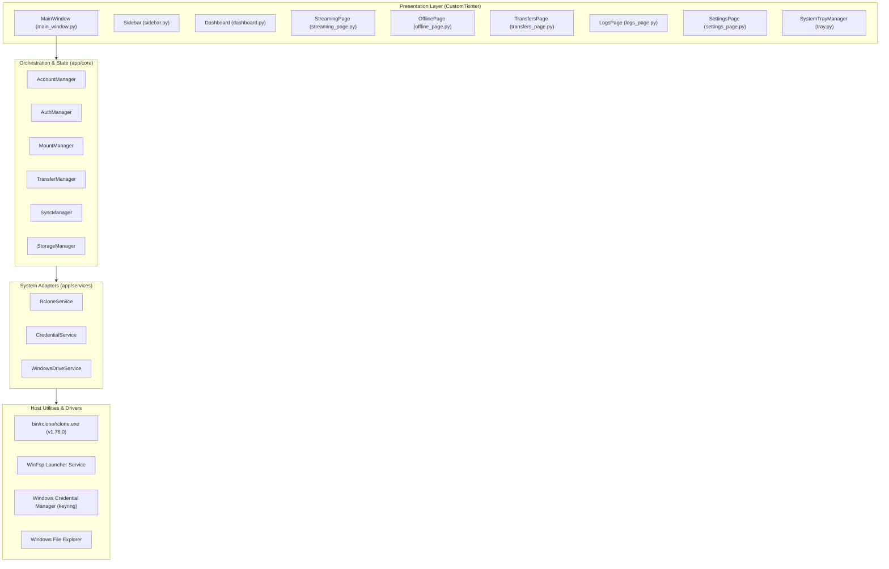

# GDrive Manager — Comprehensive Repository Audit

**Audit Date**: November 2026  
**Auditor**: Senior Windows Desktop Software Engineer & DevOps Lead  
**Scope**: Full codebase inspection of `gdrive-manager` across architecture, dependencies, GUI, authentication, rclone/WinFsp integration, credential vault, test suite, packaging, and Windows compatibility.  
**Reference Specification**: `release.md` (Phases 1–11)

---

## 1. Executive Summary

GDrive Manager is a fully functional Windows desktop application built with Python 3.12, CustomTkinter 6.0, Pillow 13.0, and bundled rclone v1.76.0. The application currently implements all core operational modes:
- **Streaming Mode**: Mounts Google Drive remotes as native Windows drive letters (`G:`, `H:`, etc.) via `rclone mount` and WinFsp with full VFS chunk caching.
- **Offline Mode**: Asynchronous file/directory synchronization (Safe Copy, Cloud Mirror with dry-run protection, and Two-Way Bi-Sync) with live JSON telemetry parsing.
- **Hybrid Storage**: Allows independent streaming mount letters and offline sync target directories for the same Google account without conflict.
- **Security**: Hardware-encrypted credential storage via Windows Credential Manager (`keyring`).
- **Windows Integration**: System tray minimization (`pystray`), native balloon notifications, autorun registry toggles (`HKCU\...\Run`), and interactive logs diagnostics.

While the core functionality is robust with 50 passing pytest tests and a working PyInstaller build, the repository currently lacks standard open-source scaffolding, CI/CD automation, dedicated developer dependency separation, an Inno Setup installer, and an original brand identity distinct from Google's official trademarks.

---

## 2. Architecture & Entry Point Analysis



### Strengths:
1. **Clear Architectural Layering**: Clean separation between presentation (`app/ui`), core state/coordination (`app/core`), external services (`app/services`), data models (`app/models`), and utilities (`app/utils`).
2. **Thread Safety**: Long-running I/O, subprocess execution, and OAuth operations are delegated to `ThreadPoolExecutor` workers, while UI mutations are safely dispatched via Tkinter's `self.after(0, ...)`.
3. **Process Supervision**: `MountManager` tracks background mount subprocesses with active PID tracking, periodic health checks, and a shutdown hook (`atexit.register(self.unmount_all)`) to prevent orphaned virtual drives.

### Technical Debt & Weaknesses:
1. **Entrypoint Bootstrapping**: `main.py` directly configures CustomTkinter appearance and instantiates `MainWindow()`. It does not accept command-line arguments (e.g., `--minimized`, `--version`, `--help`) or handle single-instance locking (e.g., via a named Windows mutex or socket).
2. **Hardcoded Version Strings**: Version strings are duplicated across `sidebar.py` (`version="v1.0.0"`), `main_window.py`, and `settings_page.py`. There is no central `app/__version__.py` or metadata resolution from `pyproject.toml`.

---

## 3. Dependency Analysis

### Current `requirements.txt`:
```
customtkinter>=5.2.0
pillow>=10.0.0
keyring>=24.0.0
pywin32>=306
pytest>=8.0.0
pytest-mock>=3.12.0
pystray>=0.19.5
pyinstaller>=6.4.0
```

### Findings:
1. **Mixed Runtime and Development Dependencies**:
   - `pytest`, `pytest-mock`, and `pyinstaller` are bundled in `requirements.txt`.
   - Production end-users do not need testing or compiler frameworks to run the application.
2. **Missing Development & QA Dependencies**:
   - `ruff` (fast linting and code formatting).
   - `mypy` (static type checking).
   - `pytest-cov` (code coverage reporting).
   - `pre-commit` (git hook enforcement).
   - `pip-audit` (vulnerability scanning for CI).
3. **Missing `pyproject.toml`**:
   - Standard PEP 517/518/621 packaging file is missing. Tool configurations (Ruff, Mypy, Pytest) are currently unconfigured or rely on defaults.

---

## 4. Brand Identity & Visual Assets Audit

### Critical Findings:
1. **Google Trademark Risk**:
   - `app/ui/assets.py` currently features `get_gdrive_icon()`, which renders Google's proprietary 3-color triangle logo (yellow `#FBBC04`, green `#34A853`, blue `#4285F4`).
   - `release.md` Section 2 strictly mandates: *"Create an original brand identity. Do not directly copy Google's official logo or create an icon that could be mistaken for an official Google product."*
2. **Missing Brand Assets**:
   - The repository lacks vector brand masters (`assets/branding/logo.svg`, `icon.svg`).
   - Missing required GitHub marketing banner (`assets/branding/github-banner.png`, 1280 × 640 px) with the authentic application screenshot and tagline *"Your Google Drives. One Desktop."*.
   - Missing GitHub social preview image (`assets/branding/social-preview.png`, 1280 × 640 px).
   - Raster icon dimensions (`icon-16.png` through `icon-256.png`) need to be generated systematically from a canonical vector source.

---

## 5. Google Drive Authentication & Credential Security

### Strengths:
1. **OAuth 2.0 via Browser**: `AuthManager` invokes rclone's built-in webserver on loopback (`127.0.0.1:53682`) to capture Google OAuth redirects, avoiding embedded webviews.
2. **Hardware-Backed Vault**: `CredentialService` uses Windows Credential Manager (`keyring`) with service name `GDriveManager`. Plaintext tokens are not written to `accounts.json`.
3. **Atomic Account Writes**: `AccountRepository` writes to a temporary staging file (`.tmp`) before replacing `accounts.json`, guarding against corruption during unexpected reboots or crashes.

### Findings & Security Considerations:
1. **Rclone Configuration Storage**:
   - `rclone.conf` is stored at `%LOCALAPPDATA%\GDriveManager\rclone.conf`.
   - While `accounts.json` contains no tokens, rclone itself retains Google OAuth refresh tokens inside `rclone.conf`.
   - Although NTFS file permissions protect user `%LOCALAPPDATA%` from standard non-admin cross-user snooping, documented guidance on rclone configuration encryption (`rclone config password`) or Windows DPAPI protection should be incorporated in `docs/security.md`.

---

## 6. Rclone & WinFsp Integration

### Strengths:
1. **Subprocess Safety**: All subprocess invocations across `rclone_service.py`, `mount_manager.py`, and `transfer_manager.py` utilize discrete argument lists (`cmd = [exe, "mount", ...]`), completely avoiding `shell=True` and raw command string injection vulnerabilities.
2. **Real-Time Telemetry**: Transfer tracking utilizes `--use-json-log --stats 1s --stats-log-level NOTICE`, allowing clean parsing of rclone's JSON status events on stderr without screen scraping.
3. **WinFsp Driver Verification**: Thorough pre-flight checks in `platform_checks.py` inspect both `Program Files` locations and query the Windows Service Control Manager (`sc query winfsp-launcher`).

### Findings:
1. **Log Directory in Installed Context**:
   - In `app/utils/paths.py`:
     ```python
     LOGS_DIR = BASE_DIR / "logs"
     ```
   - When GDrive Manager is installed into `C:\Program Files\GDriveManager`, attempting to write to `BASE_DIR / "logs"` without administrative privileges will fail with `PermissionError` (Access Denied).
   - **Remediation**: `LOGS_DIR` must point to `get_app_data_dir() / "logs"` (`%LOCALAPPDATA%\GDriveManager\logs`) in production builds.

---

## 7. Storage Management & Hybrid Mode

### Strengths:
1. **Isolated Metrics**: `StorageManager` accurately isolates Cloud Quota (retrieved from `rclone about`), Local Offline Storage (scanned from disk), and VFS Streaming Cache chunks.
2. **Safe Cache Purging**: Provides one-click VFS cache purging that purges local disk chunk files while safely preserving cloud data.
3. **Target Overlap Guard**: `DriveSettingsDialog` validates that local offline directories cannot be configured inside the virtual mount letter of the same drive, preventing recursive sync loops.

---

## 8. Testing & Quality Assurance Audit

### Current Status:
- **Test Count**: 50 tests collected and passing across 13 test files.
- **Duration**: ~4.1 seconds.

### Gaps & Technical Debt:
1. **Test Directory Structure**:
   - All tests currently reside in a single flat directory `tests/`.
   - Per `release.md`, tests should be organized into:
     - `tests/unit/`: Testing isolated business logic, models, parsers, and utilities.
     - `tests/integration/`: Testing multi-component flows (e.g., MountManager lifecycle, SyncManager dry-runs, telemetry streams).
     - `tests/fixtures/`: Shared test data and mock objects.
2. **Coverage Configuration**:
   - No `.coveragerc` or `pytest-cov` integration. Current test coverage percentage is unmeasured. Target is $\ge 80\%$ testable business logic coverage.
3. **Linter & Type Checking**:
   - No `ruff.toml` or `pyproject.toml` linting configuration.
   - No `mypy.ini` configuration.

---

## 9. Packaging, Inno Setup & CI/CD Workflows

### Current State:
- `build.py` and `gdrive_manager.spec` produce a functioning onedir standalone executable in `dist/GDriveManager/GDriveManager.exe`.

### Missing Deliverables:
1. **Portable ZIP Archive**:
   - Need automated script/target to compress `dist/GDriveManager` into `GDriveManager-Windows-x64.zip` without transient or development files.
2. **Inno Setup Windows Installer**:
   - Missing `packaging/windows/installer.iss` to build `GDriveManager-Setup-x64.exe`.
   - Must configure Start Menu shortcuts, optional desktop shortcut, uninstaller, icon integration, and WinFsp detection notices.
3. **GitHub Workflows (`.github/workflows/`)**:
   - No CI workflow (`ci.yml`): Lint, typecheck, compile, test on Windows runners.
   - No build workflow (`build-windows.yml`): Build portable zip and executable.
   - No release workflow (`release.yml`): Trigger on tag `v*.*.*`, generate `SHA256SUMS.txt`, draft release notes, and upload release assets.
   - No security workflow (`security.yml` with `pip-audit`).
   - No Dependabot configuration (`.github/dependabot.yml`).

---

## 10. Open-Source Documentation & Standards

### Missing Files:
- `docs/installation.md`
- `docs/architecture.md`
- `docs/configuration.md`
- `docs/troubleshooting.md`
- `docs/development.md`
- `docs/security.md`
- `CONTRIBUTING.md`
- `CODE_OF_CONDUCT.md`
- `CHANGELOG.md`
- `SECURITY.md`
- `LICENSE` (Needs selection/confirmation)
- `.github/ISSUE_TEMPLATE/bug_report.yml`
- `.github/ISSUE_TEMPLATE/feature_request.yml`
- `.github/PULL_REQUEST_TEMPLATE.md`

---

## 11. Prioritized Improvement Plan (Phases 2–11)

| Phase | Milestone | Priority Actions |
|---|---|---|
| **Phase 2** | **Improvement Proposals** | Plan architectural refactoring, dependency split (`requirements.txt` vs `requirements-dev.txt`), version single-sourcing, and `pyproject.toml`. |
| **Phase 3** | **Brand Identity & Assets** | Design original geometric logo (avoiding Google trademark), create `logo.svg`, `icon.svg`, multi-res `icon.ico`, compose `github-banner.png` (using uploaded screenshot) and `social-preview.png`. |
| **Phase 4** | **Repository Structure** | Scaffold `.github/`, `docs/`, `scripts/`, `packaging/windows/`, restructure `tests/unit/` & `tests/integration/`. |
| **Phase 5** | **Documentation** | Build rich, production-grade `README.md`, full suite of `docs/*.md`, and GitHub community standards (`CONTRIBUTING.md`, etc.). |
| **Phase 6** | **QA & Code Quality** | Configure `pyproject.toml`, Ruff, Mypy, pre-commit, enforce coverage $\ge 80\%$. |
| **Phase 7** | **GitHub Actions CI** | Create `.github/workflows/ci.yml` targeting Windows GitHub runners. |
| **Phase 8** | **Windows Build Automation** | Create `.github/workflows/build-windows.yml` and portable `GDriveManager-Windows-x64.zip`. |
| **Phase 9** | **Inno Setup Installer** | Write `packaging/windows/installer.iss` producing `GDriveManager-Setup-x64.exe`. |
| **Phase 10** | **Automated Releases** | Create `.github/workflows/release.yml`, version validation, `SHA256SUMS.txt`, automated release publishing. |
| **Phase 11** | **Final Verification** | Comprehensive end-to-end execution of all builds, tests, installers, and verification checklist. |
