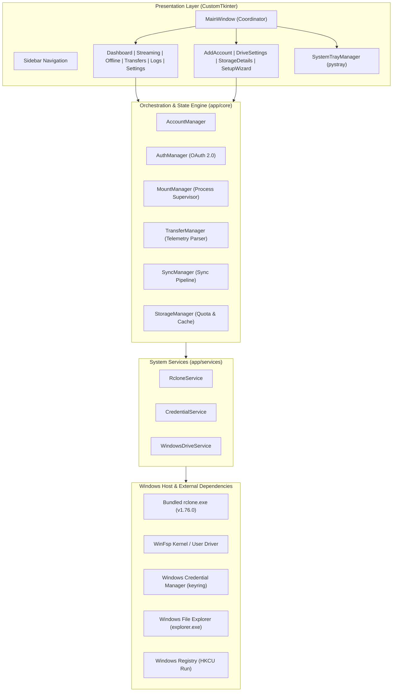
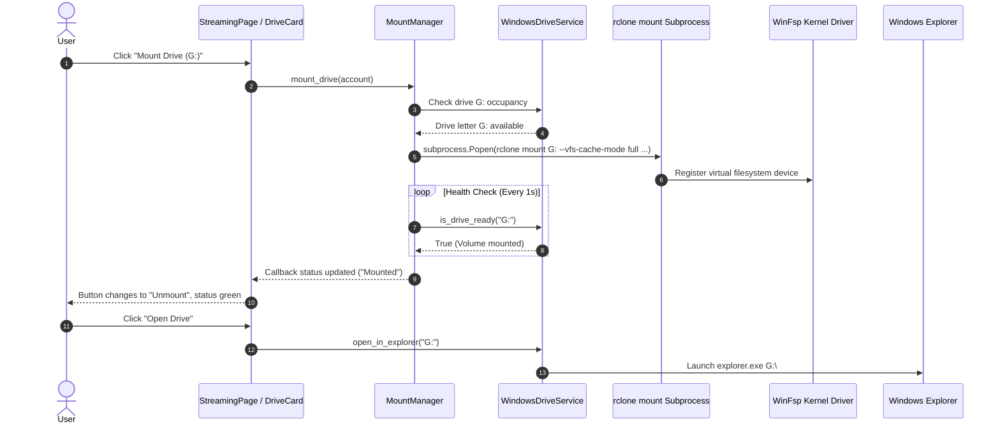
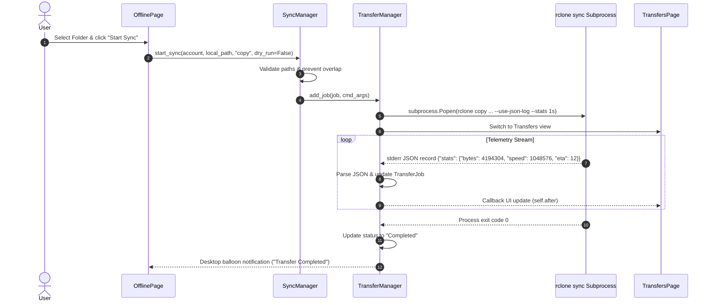

# GDrive Manager — System Architecture & Technical Design

This document details the internal architecture, component interactions, threading model, and security design of GDrive Manager.

---

## 1. High-Level Architecture Overview

GDrive Manager is designed as a layered, modular desktop application bridging Windows File Explorer with Google Drive cloud storage. It pairs **rclone** (for high-throughput cloud storage operations and OAuth 2.0 orchestration) and **WinFsp** (Windows File System Proxy, for native Windows drive letter virtualization) behind a modern dark navy UI.

---

## 2. Core Architectural Components

### 2.1 Presentation Layer (`app/ui/`)
- **`MainWindow`** (`app/ui/main_window.py`): Root application coordinator inheriting from `customtkinter.CTk`. Manages view switching (`show_page`), global lifecycle shutdown hooks (`WM_DELETE_WINDOW`), system tray integration, and onboarding triggers.
- **`Sidebar`** (`app/ui/sidebar.py`): Collapsible left navigation panel displaying active view states, quick "+ Add Drive" primary action, account counters, and bottom system status indicator.
- **Views**:
  - `Dashboard`: Responsive grid of connected `DriveCard` components with aggregate cloud quota summaries.
  - `StreamingPage`: WinFsp virtual drive mount manager with mount/unmount triggers, drive letter assignments, and cache controls.
  - `OfflinePage`: Selective directory synchronization hub (Safe Copy, Cloud Mirror, Local Mirror, Two-Way Bi-Sync).
  - `TransfersPage`: Asynchronous transfer queue displaying real-time speed, progress bars, ETA countdowns, and job controls (Pause, Resume, Cancel, Retry).
  - `LogsPage`: Live diagnostic log inspector supporting log level filtering (`ALL`, `INFO`, `WARNING`, `ERROR`, `DEBUG`) and Notepad launcher.
  - `SettingsPage`: System autorun registry toggle, system tray minimize preferences, default cache paths, and diagnostics.
- **Thread Safety Model**: CustomTkinter widgets must only be mutated on the main GUI thread. All background callbacks from `MountManager`, `TransferManager`, and `AuthManager` dispatch GUI updates via `self.after(0, callback)`.

### 2.2 Core Orchestration Layer (`app/core/`)
- **`AccountManager`** (`app/core/account_manager.py`): Manages the in-memory collection of accounts, delegating persistence to `AccountRepository`. Provides dynamic sample previews if no live accounts are configured.
- **`AuthManager`** (`app/core/auth_manager.py`): Executes Google OAuth 2.0 authorization asynchronously. Spawns rclone's temporary local loopback webserver (`127.0.0.1:53682`), retrieves cloud quota upon authorization, and stores credentials in Windows Credential Manager.
- **`MountManager`** (`app/core/mount_manager.py`): Supervises the active `rclone mount` subprocess lifecycles. Features:
  - Background health monitoring thread (`MountMonitor`).
  - Safe subprocess argument construction (no raw shell execution).
  - Drive letter collision validation against Windows logical drives.
  - Automated teardown registered via `atexit` to prevent orphaned mounts.
- **`TransferManager`** (`app/core/transfer_manager.py`): Supervises active, queued, and completed file operations. Spawns rclone with `--use-json-log --stats 1s --stats-log-level NOTICE`, reading stderr lines in real-time to extract exact byte counters, throughput speeds, and ETAs.
- **`SyncManager`** (`app/core/sync_manager.py`): Constructs validated rclone commands for `copy`, `sync`, and `bisync`. Enforces safety prompts for destructive mirror deletions and prevents overlapping transfer tasks.
- **`StorageManager`** (`app/core/storage_manager.py`): Isolates three storage tiers:
  1. *Cloud Quota*: Polled from Google Drive via `rclone about`.
  2. *Local Offline Storage*: Scanned from local target directories on disk.
  3. *VFS Streaming Cache*: Scanned from `%LOCALAPPDATA%\GDriveManager\vfs_cache`. Allows one-click cache purging without deleting cloud data.

### 2.3 System Adapters (`app/services/`)
- **`RcloneService`** (`app/services/rclone_service.py`): Discovers and interfaces with the rclone binary (`bin/rclone/rclone.exe`). Manages isolated application configuration (`rclone.conf`) in user AppData.
- **`CredentialService`** (`app/services/credential_service.py`): Hardware-encrypted token vault interfacing with Windows Credential Manager via `keyring`. Eliminates plaintext OAuth secrets from disk.
- **`WindowsDriveService`** (`app/services/windows_drive_service.py`): Interacts with Windows Shell and Win32 APIs to detect volume readiness and open virtual drive letters directly in `explorer.exe`.

---

## 3. Data & Process Flow

### 3.1 Streaming Mount Lifecycle

### 3.2 Real-Time Transfer Telemetry

---

## 4. File Locations & Directory Layout

| Data Type | Location | Purpose |
|---|---|---|
| **Executable** | `dist\GDriveManager\GDriveManager.exe` | Compiled portable application executable |
| **Bundled Engine** | `bin\rclone\rclone.exe` | Embedded cloud engine binary |
| **Account Metadata** | `%LOCALAPPDATA%\GDriveManager\accounts.json` | Non-sensitive account metadata (atomic writes) |
| **Rclone Config** | `%LOCALAPPDATA%\GDriveManager\rclone.conf` | Isolated rclone remotes configuration |
| **Credential Vault** | Windows Credential Manager (`GDriveManager`) | Hardware-encrypted OAuth refresh tokens |
| **VFS Streaming Cache**| `%LOCALAPPDATA%\GDriveManager\vfs_cache\` | Temporary chunk cache for streaming virtual drives |
| **Diagnostic Logs** | `%LOCALAPPDATA%\GDriveManager\logs\app.log` | Rotating log file (5 MB limit, 3 backups) |
| **Onboarding State** | `%LOCALAPPDATA%\GDriveManager\.onboarding_completed` | Marker flag tracking setup wizard completion |
